# Hi, I'm Nitesh Kumar 👋

  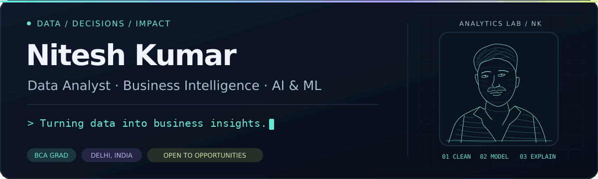

**[Live demos](#live-demos)** · **[Featured projects](#featured-projects)** · **[Skills](#skills)** · **[Connect](#connect)**

I'm a **BCA graduate based in Delhi, India**, building practical analytics projects with Python, SQL, Excel and Power BI. I turn business questions into clear dashboards, useful reports and evaluated machine-learning models.

**Open to:** Entry-level Data Analyst, Business Analyst and MIS Executive roles, internships and analytics collaborations.

## Live demos

<table width="100%">
  <tr>
    <td width="50%" valign="top" align="center">
      <a href="https://nitesh-datascience.github.io/CodeVenjar/">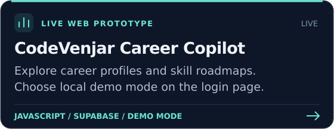</a> 
      <a href="https://nitesh-datascience.github.io/CodeVenjar/"><strong>Open live demo ↗</strong></a> · <a href="https://github.com/Nitesh-Datascience/CodeVenjar">Source code</a> 
      Choose “Use local demo” and create a local demo ID.
    </td>
    <td width="50%" valign="top" align="center">
      <a href="https://privyscan-ai-starter-afe9ltswbslgt9vkczfvxx.streamlit.app/">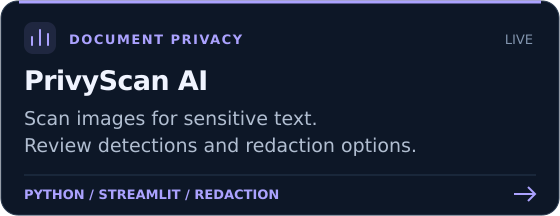</a> 
      <a href="https://privyscan-ai-starter-afe9ltswbslgt9vkczfvxx.streamlit.app/"><strong>Open live demo ↗</strong></a> 
      If the app is asleep, choose “Yes, get this app back up!”
    </td>
  </tr>
</table>

## Featured projects

Business analytics, reporting and machine learning — each card links to its repository, with setup instructions in the project guide.

<table width="100%">
  <tr>
    <td width="50%" valign="top" align="center">
      <a href="https://github.com/Nitesh-Datascience/Nassau_Candy_Profitability_Project">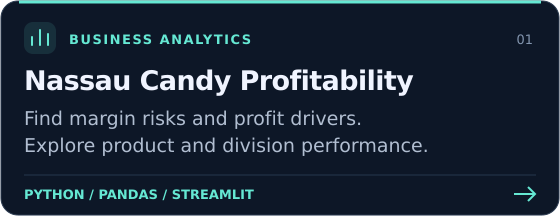</a> 
      <a href="https://github.com/Nitesh-Datascience/Nassau_Candy_Profitability_Project"><strong>Source code</strong></a> · <a href="https://github.com/Nitesh-Datascience/Nassau_Candy_Profitability_Project#readme">Project guide</a>
    </td>
    <td width="50%" valign="top" align="center">
      <a href="https://github.com/Nitesh-Datascience/Sales-MIS-Dashboard-Project-using-Excel">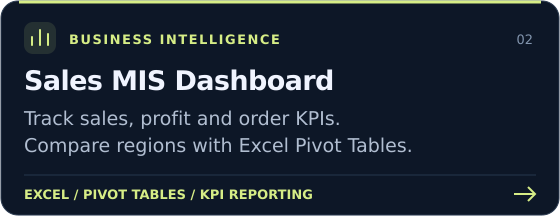</a> 
      <a href="https://github.com/Nitesh-Datascience/Sales-MIS-Dashboard-Project-using-Excel"><strong>Source code</strong></a> · <a href="https://github.com/Nitesh-Datascience/Sales-MIS-Dashboard-Project-using-Excel#readme">Project guide</a>
    </td>
  </tr>
  <tr>
    <td width="50%" valign="top" align="center">
      <a href="https://github.com/Nitesh-Datascience/Customer_churn_Prediction">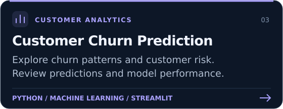</a> 
      <a href="https://github.com/Nitesh-Datascience/Customer_churn_Prediction"><strong>Source code</strong></a> · <a href="https://github.com/Nitesh-Datascience/Customer_churn_Prediction#readme">Project guide</a>
    </td>
    <td width="50%" valign="top" align="center">
      <a href="https://github.com/Nitesh-Datascience/Financial_Fraud_Detection">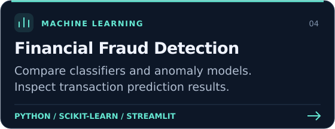</a> 
      <a href="https://github.com/Nitesh-Datascience/Financial_Fraud_Detection"><strong>Source code</strong></a> · <a href="https://github.com/Nitesh-Datascience/Financial_Fraud_Detection#readme">Project guide</a>
    </td>
  </tr>
  <tr>
    <td width="50%" valign="top" align="center">
      <a href="https://github.com/Nitesh-Datascience/FORESIGHT_AI_Demand_Inventory_Intelligence">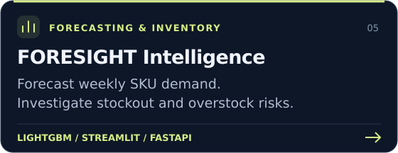</a> 
      <a href="https://github.com/Nitesh-Datascience/FORESIGHT_AI_Demand_Inventory_Intelligence"><strong>Source code</strong></a> · <a href="https://github.com/Nitesh-Datascience/FORESIGHT_AI_Demand_Inventory_Intelligence#readme">Project guide</a>
    </td>
    <td width="50%" valign="top" align="center">
      <a href="https://github.com/Nitesh-Datascience/EduPro_Project">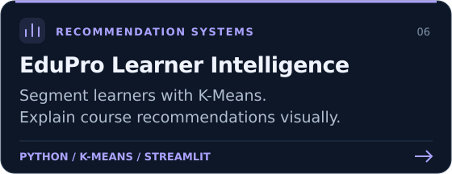</a> 
      <a href="https://github.com/Nitesh-Datascience/EduPro_Project"><strong>Source code</strong></a> · <a href="https://github.com/Nitesh-Datascience/EduPro_Project#readme">Project guide</a>
    </td>
  </tr>
</table>

**More work:** [APL Logistics Analytics](https://github.com/Nitesh-Datascience/https---github.com-Nitesh-Datascience-APL_Logistics) · [Shopping Behavior Analysis](https://github.com/Nitesh-Datascience/Customer-Shopping-Behavior-Analysis) · [Care Transition Analytics](https://github.com/Nitesh-Datascience/care-transition-efficiency-analytics) · [Smart Water Tank Monitoring](https://github.com/Nitesh-Datascience/IOT-BASED-Smart-Water-Tank-Monitoring-System)

**[Browse all repositories →](https://github.com/Nitesh-Datascience?tab=repositories)**

## Skills

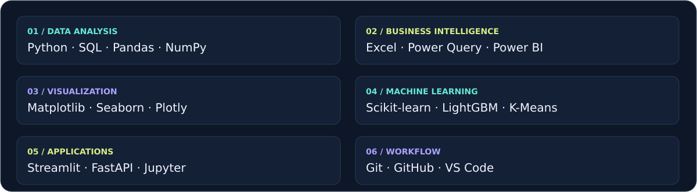

**How I work:** Define the business question → clean and explore the data → build and evaluate → explain the findings.

## Connect

Interested in an analytics role, dashboard project or collaboration? Let's connect.

  
  
  <a href="https://nitesh-datascience.github.io/portfolio/">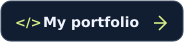</a>

**[LinkedIn](https://www.linkedin.com/in/niteshkumar-codlytic)** · **[ns0762005@gmail.com](mailto:ns0762005@gmail.com)** · **[Portfolio](https://nitesh-datascience.github.io/portfolio/)**

---

<strong>Clear analysis. Useful dashboards. Better decisions.</strong>

