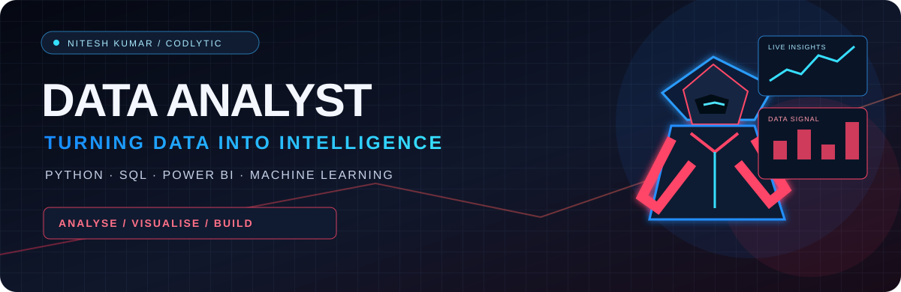
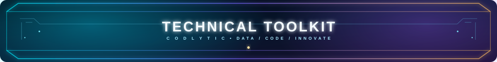
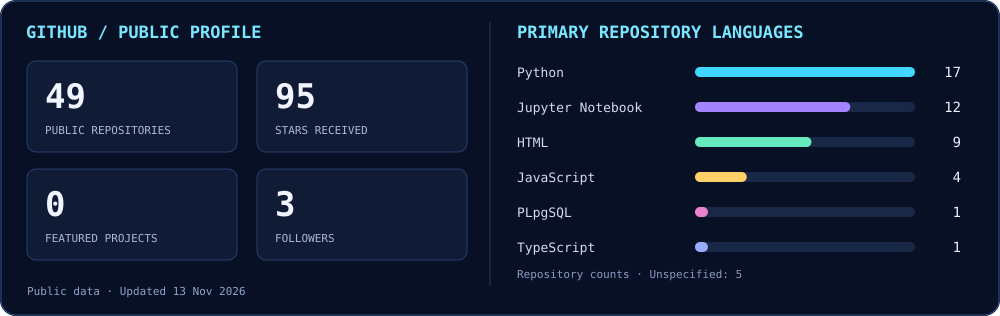
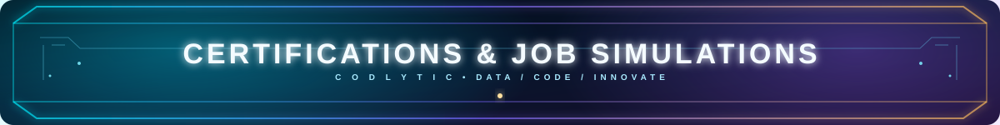
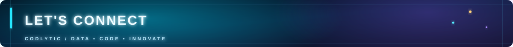

<!-- CODLYTIC | GITHUB PROFILE -->

  

  <strong>DATA ANALYST</strong> &nbsp;·&nbsp;
  
  
  
  

  
  &nbsp;
  
  &nbsp;
  

I turn data into clear insights and practical solutions. My work spans data cleaning, exploratory analysis, dashboards, business intelligence, and applied machine learning. I enjoy finding patterns, explaining what they mean, and building tools that help people make better decisions.

**My approach:** Explore the data → find the signal → communicate the insight → support action.

  

  
  
  
  
  

| Data analytics | Business intelligence | Machine learning |
|:--|:--|:--|
| Data cleaning · EDA · SQL · Statistics | Excel · Power BI · KPI dashboards · Reporting | Classification · Clustering · Forecasting · Model evaluation |

A collection of analytics dashboards, predictive models, and interactive applications.

| Project | What it explores | Links |
|:--|:--|:--|
| **Care Transition Analytics** | Care pipeline, transfer efficiency and placement outcomes. | [Live demo](https://care-transition-efficiency-analytics-knfy8ljtaxyn8ti74zy5ng.streamlit.app/) · [Source](https://github.com/Nitesh-Datascience/care-transition-efficiency-analytics) |
| **Customer Churn Prediction** | Customer segments, churn risk and model performance. | [Live demo](https://customerchurnprediction-fkpbjib3muyvrhmgchkurb.streamlit.app/) · [Source](https://github.com/Nitesh-Datascience/Customer_churn_Prediction) |
| **EduPro Learner Intelligence** | Learner clusters, course recommendations and model comparisons. | [Live demo](https://eduproproject-jkoe6q6tctk5xafa6ggogf.streamlit.app/) · [Source](https://github.com/Nitesh-Datascience/EduPro_Project) |
| **Financial Fraud Detection** | Transaction risk, anomaly patterns and classifier comparisons. | [Live demo](https://financialfrauddetection-6geni2xkrt3dc8ry2infsf.streamlit.app/) · [Source](https://github.com/Nitesh-Datascience/Financial_Fraud_Detection) |
| **FORESIGHT · NorthBay Living** | Demand forecasts, inventory risks and replenishment planning. | [Live demo](https://foresightnorthbay-ufqepslzgzysttnkue79rx.streamlit.app/) · [Source](https://github.com/Nitesh-Datascience/foresight_northbay) |
| **APL Logistics Analytics** | Delivery performance and delay-risk reporting; access required. | [Live demo](https://https---appcom-nitesh-datascience-apllogistics-464avyacan3btze.streamlit.app/) · [Source](https://github.com/Nitesh-Datascience/https---github.com-Nitesh-Datascience-APL_Logistics) |
| **Nassau Candy Profitability** | Product economics, margin risk and division performance. | [Live demo](https://87v6ndywgm2xvutswekgjm.streamlit.app/) · [Source](https://github.com/Nitesh-Datascience/Nassau_Candy_Profitability_Project) |
| **Restaurant Growth Analytics** | Explore the restaurant growth analysis dashboard. | [Live demo](https://restaurantgrowthproject-jealfjvy6prolwkmv47cen.streamlit.app/) · [Source](https://github.com/Nitesh-Datascience/restaurant_growth_project) |
| **PrivyScan AI** | Document-image sensitive text detection and redaction prototype. | [Live demo](https://privyscan-ai-starter-afe9ltswbslgt9vkczfvxx.streamlit.app/) · Source link not listed |
| **CodeVenjar** | Career planning web prototype; choose “Use local demo” to begin. | [Live demo](https://nitesh-datascience.github.io/CodeVenjar/) · [Source](https://github.com/Nitesh-Datascience/CodeVenjar) |
| **Nitesh Tree Portfolio** | Interactive tree portfolio with project details, filters and animated letters. | [Live demo](https://nitesh-datascience.github.io/Nitesh-Tree-Portfolio/) · [Source](https://github.com/Nitesh-Datascience/Nitesh-Tree-Portfolio) |
| **universe portfolio** | Explore the deployed project and its source code. | [Live demo](https://nitesh-datascience.github.io/Codlytic-portfolio/) · [Source](https://github.com/Nitesh-Datascience/universe-portfolio) |
| **DIWALI UNIVERSE 2026** | Explore the deployed project and its source code. | [Live demo](https://nitesh-datascience.github.io/DIWALI-UNIVERSE-2026/) · [Source](https://github.com/Nitesh-Datascience/DIWALI-UNIVERSE-2026) |

  

  

  <a href="https://github.com/Nitesh-Datascience?tab=repositories">Browse repositories</a> &nbsp;·&nbsp;
  <a href="https://github.com/Nitesh-Datascience?tab=stars">Starred repositories</a>

| Organisation | Credential | Issued |
|:--|:--|:--|
| J.P. Morgan · Forage | Quantitative Research Job Simulation · `EHKW2tShz7KYgf565` | Jan 2026 |
| Commonwealth Bank · Forage | Introduction to Data Science Job Simulation · `tj5K6zabsnJiNgXkN` | Jan 2026 |
| Tata · Forage | GenAI Powered Data Analytics Job Simulation · `Cfk328SFy3pswneyo` | Jan 2026 |
| AWS · Forage | Solutions Architecture Job Simulation · `thyTv3SM9z6LMnHRR` | Jan 2026 |
| Forage Academy | Data Labeling Job Simulation · `KBxCEfzfqigNR73Xj` | Jan 2026 |
| SkillCourse | Microsoft Excel with A.I Masterclass · `SC-1C2DD33A41` | Jan 2026 |
| IBM SkillsBuild | Artificial Intelligence Fundamentals | — |
| Deloitte · Forage | Data Analytics Job Simulation · `H9GpEgwr3scGTJKGZ` | Jul 2025 |
| Canva | Canva Essentials · `74b50f` | Nov 2024 |

  <a href="https://nitesh-datascience.github.io/universe-portfolio/">Universe Portfolio</a> &nbsp;·&nbsp;
  <a href="https://github.com/Nitesh-Datascience/universe-portfolio">Portfolio source</a> &nbsp;·&nbsp;
  <a href="https://nitesh-datascience.github.io/portfolio/">Main portfolio</a> &nbsp;·&nbsp;
  <a href="https://nitesh-datascience.github.io/Nitesh-Tree-Portfolio/">Tree portfolio</a>

  
  

CODLYTIC · DATA · CODE · INNOVATE

