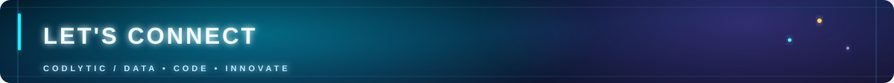

<!-- CODLYTIC | GitHub Profile README -->

<!-- HERO -->

  

  
  
  
  

  
  
  

<!-- ABOUT -->

  

  

<!-- TOOLKIT -->

  

  

  
  
  
  
  

<!-- FEATURED PROJECTS -->

  

<strong>SELECTED WORK</strong> · Analytics, AI, and developer projects.

  

<!-- CONTRIBUTION GRAPH -->

  

<!-- 3D CONTRIBUTION CALENDAR -->

  

<!-- CONTRIBUTION SNAKE -->

  <picture>
    <source media="(prefers-color-scheme: dark)" srcset="https://raw.githubusercontent.com/Nitesh-Datascience/Nitesh-Datascience/output/github-contribution-grid-snake-dark.svg" />
    <source media="(prefers-color-scheme: light)" srcset="https://raw.githubusercontent.com/Nitesh-Datascience/Nitesh-Datascience/output/github-contribution-grid-snake.svg" />
    
  </picture>

<!-- GITHUB ACTIVITY -->

  

  

  

  

  <a href="https://github.com/Nitesh-Datascience?tab=repositories">Browse repositories</a>
  &nbsp;·&nbsp;
  <a href="https://github.com/Nitesh-Datascience?tab=stars">Starred repositories</a>

<!-- CERTIFICATIONS -->

  

  
  
  

<table>
  <tr>
    <td width="33%" valign="top">
      
<strong>01 · QUANTITATIVE RESEARCH</strong>

      
<strong>J.P. MORGAN</strong> Forage · Jan 2026

      
<code>EHKW2tShz7KYgf565</code>

    </td>
    <td width="33%" valign="top">
      
<strong>02 · DATA SCIENCE</strong>

      
<strong>COMMONWEALTH BANK</strong> Forage · Jan 2026

      
<code>tj5K6zabsnJiNgXkN</code>

    </td>
    <td width="33%" valign="top">
      
<strong>03 · GENAI DATA ANALYTICS</strong>

      
<strong>TATA</strong> Forage · Jan 2026

      
<code>Cfk328SFy3pswneyo</code>

    </td>
  </tr>
  <tr>
    <td width="33%" valign="top">
      
<strong>04 · SOLUTIONS ARCHITECTURE</strong>

      
<strong>AWS</strong> Forage · Jan 2026

      
<code>thyTv3SM9z6LMnHRR</code>

    </td>
    <td width="33%" valign="top">
      
<strong>05 · DATA LABELING</strong>

      
<strong>FORAGE ACADEMY</strong> Jan 2026

      
<code>KBxCEfzfqigNR73Xj</code>

    </td>
    <td width="33%" valign="top">
      
<strong>06 · EXCEL WITH A.I</strong>

      
<strong>SKILLCOURSE</strong> Self Learning · Jan 2026

      
<code>SC-1C2DD33A41</code>

    </td>
  </tr>
  <tr>
    <td width="33%" valign="top">
      
<strong>07 · AI FUNDAMENTALS</strong>

      
<strong>IBM SKILLSBUILD</strong> Date not listed

      
Credential ID not provided

    </td>
    <td width="33%" valign="top">
      
<strong>08 · DATA ANALYTICS</strong>

      
<strong>DELOITTE</strong> Jul 2025

      
<code>H9GpEgwr3scGTJKGZ</code>

    </td>
    <td width="33%" valign="top">
      
<strong>09 · CANVA ESSENTIALS</strong>

      
<strong>CANVA</strong> Nov 2024

      
<code>74b50f</code>

    </td>
  </tr>
</table>

CONTINUOUS LEARNING · PRACTICAL PROJECTS · DATA-DRIVEN THINKING

<!-- MORE -->

  

  <a href="https://nitesh-datascience.github.io/universe-portfolio/">Universe Portfolio</a>
  &nbsp;·&nbsp;
  <a href="https://github.com/Nitesh-Datascience/universe-portfolio">Portfolio source</a>
  &nbsp;·&nbsp;
  <a href="https://nitesh-datascience.github.io/portfolio/">Main portfolio</a>
  &nbsp;·&nbsp;
  <a href="https://nitesh-datascience.github.io/Nitesh-Tree-Portfolio/">Tree portfolio</a>

<!-- CONNECT -->

  

  
  

  

