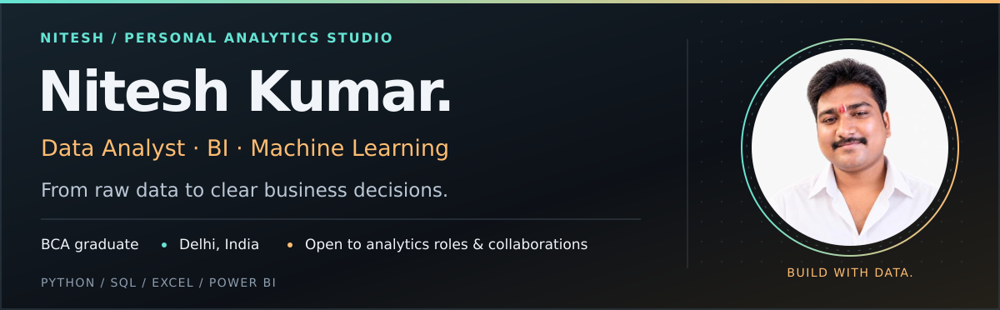
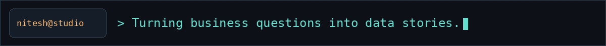
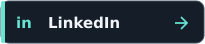
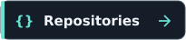

# Hi, I'm Nitesh 👋

  
  
  

**[About me](#user-content-about-me)** · **[Projects](#user-content-featured-projects)** · **[Live demo](#user-content-live-demo)** · **[Skills](#user-content-skills-and-tools)** · **[Connect](#user-content-connect)**

## About me

I'm **Nitesh Kumar**, a **BCA graduate based in Delhi, India**, building a career in data analytics and business intelligence. My projects cover sales reporting, profitability, customer behavior, forecasting and machine learning.

I work through the whole analysis: **understand the question, clean the data, build and evaluate, and explain the findings**. I use dashboards and clear documentation to make the results easier to explore.

- **Building:** Python dashboards, Excel reports, forecasting tools and recommendation systems.
- **Practicing:** SQL, statistics, model evaluation and business reporting through hands-on projects.
- **Open to:** Entry-level Data Analyst, Business Analyst and MIS Executive roles, internships and analytics collaborations.

## Featured projects

The first two previews come directly from my project repositories. Explore the source code and project guides for setup, methods and results.

<table align="center">
  <tr>
    <td width="50%" valign="top">
      <h3>Nassau Candy Profitability</h3>
      

      
Explore product margins, profit concentration and division performance in a profitability dashboard.

      
<code>Python · Pandas · Streamlit</code>

      
<a href="https://github.com/Nitesh-Datascience/Nassau_Candy_Profitability_Project"><strong>Source code ↗</strong></a> · <a href="https://github.com/Nitesh-Datascience/Nassau_Candy_Profitability_Project#readme">Read project guide</a>

    </td>
    <td width="50%" valign="top">
      <h3>Sales MIS Dashboard</h3>
      

      
Track sales, profit, order KPIs and regional trends with an Excel reporting dashboard.

      
<code>Excel · KPI reporting · Dashboard charts</code>

      
<a href="https://github.com/Nitesh-Datascience/Sales-MIS-Dashboard-Project-using-Excel"><strong>Source code ↗</strong></a> · <a href="https://github.com/Nitesh-Datascience/Sales-MIS-Dashboard-Project-using-Excel#readme">Read project guide</a> · <a href="https://github.com/Nitesh-Datascience/Sales-MIS-Dashboard-Project-using-Excel/raw/refs/heads/main/mis_dataset_template.xlsx">Download Excel workbook</a>

    </td>
  </tr>
  <tr>
    <td width="50%" valign="top">
      <h3>Customer Churn Prediction</h3>
      

      
Investigate churn patterns, inspect customer risk predictions and review model performance.

      
<code>Python · Machine learning · Streamlit</code>

      
<a href="https://github.com/Nitesh-Datascience/Customer_churn_Prediction"><strong>Source code ↗</strong></a> · <a href="https://github.com/Nitesh-Datascience/Customer_churn_Prediction#readme">Read project guide</a>

    </td>
    <td width="50%" valign="top">
      <h3>Financial Fraud Detection</h3>
      

      
Compare classifiers and anomaly-detection models, then inspect transaction predictions.

      
<code>Python · Scikit-learn · Streamlit</code>

      
<a href="https://github.com/Nitesh-Datascience/Financial_Fraud_Detection"><strong>Source code ↗</strong></a> · <a href="https://github.com/Nitesh-Datascience/Financial_Fraud_Detection#readme">Read project guide</a>

    </td>
  </tr>
  <tr>
    <td width="50%" valign="top">
      <h3>FORESIGHT: Demand &amp; Inventory</h3>
      

      
Forecast weekly SKU demand with rolling backtests and analyze stockout and overstock risks.

      
<code>LightGBM · Streamlit · FastAPI</code>

      
<a href="https://github.com/Nitesh-Datascience/FORESIGHT_AI_Demand_Inventory_Intelligence"><strong>Source code ↗</strong></a> · <a href="https://github.com/Nitesh-Datascience/FORESIGHT_AI_Demand_Inventory_Intelligence#readme">Read project guide</a>

    </td>
    <td width="50%" valign="top">
      <h3>EduPro Learner Intelligence</h3>
      

      
Segment learners with K-Means and explore explainable course recommendations and learner maps.

      
<code>Python · K-Means · Streamlit</code>

      
<a href="https://github.com/Nitesh-Datascience/EduPro_Project"><strong>Source code ↗</strong></a> · <a href="https://github.com/Nitesh-Datascience/EduPro_Project#readme">Read project guide</a>

    </td>
  </tr>
</table>

## Live demo

### 🛡️ PrivyScan AI — document privacy prototype

Detect sensitive text in document images and explore redaction controls in a public Streamlit app.

**[Launch PrivyScan AI ↗](https://privyscan-ai-starter-afe9ltswbslgt9vkczfvxx.streamlit.app/)**

If Streamlit puts the app to sleep, select **“Yes, get this app back up!”** to wake it.

### 💻 CodeVenjar — career planning prototype

Explore career profiles, skill gaps, learning roadmaps and portfolio features. The web prototype supports **local demo mode**; choose **“Use local demo”**, then create a local demo ID on the page.

**[Open web prototype ↗](https://nitesh-datascience.github.io/CodeVenjar/)** · **[Source code](https://github.com/Nitesh-Datascience/CodeVenjar)**

## Skills and tools

  
  
  
  

  
  
  
  

| Area | Tools and techniques |
| --- | --- |
| **Data analysis** | Python, SQL, Pandas, NumPy, cleaning and exploratory analysis |
| **Business intelligence** | Excel, Pivot Tables, Power Query, Power BI and KPI reporting |
| **Visualization** | Matplotlib, Seaborn, Plotly and data storytelling |
| **Machine learning** | Scikit-learn, classification, K-Means, LightGBM and model evaluation |
| **Applications** | Streamlit, FastAPI and Jupyter Notebook |
| **Development workflow** | Git, GitHub and VS Code |

## More from my GitHub

| Project | Focus |
| --- | --- |
| [APL Logistics Analytics](https://github.com/Nitesh-Datascience/https---github.com-Nitesh-Datascience-APL_Logistics) | Delivery performance, delay risk and logistics reporting |
| [Customer Shopping Behavior](https://github.com/Nitesh-Datascience/Customer-Shopping-Behavior-Analysis) | Shopping patterns, customer segments and exploratory analysis |
| [Care Transition Analytics](https://github.com/Nitesh-Datascience/care-transition-efficiency-analytics) | Care-transition efficiency and reporting |
| [Smart Water Tank Monitoring](https://github.com/Nitesh-Datascience/IOT-BASED-Smart-Water-Tank-Monitoring-System) | IoT monitoring project |

  
  

## Connect

I'm interested in analytics opportunities, practical dashboard projects and collaborations.

  
  
  

**Email:** [ns0762005@gmail.com](mailto:ns0762005@gmail.com)  
**LinkedIn:** [Nitesh Kumar](https://www.linkedin.com/in/niteshkumar-codlytic)  
**Portfolio:** [nitesh-datascience.github.io/portfolio](https://nitesh-datascience.github.io/portfolio/)

---

<strong>Build with curiosity. Analyze with care. Explain with clarity.</strong>

