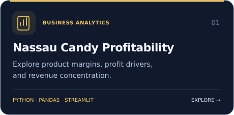
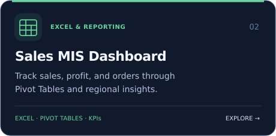
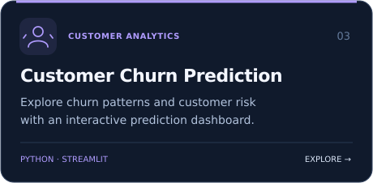
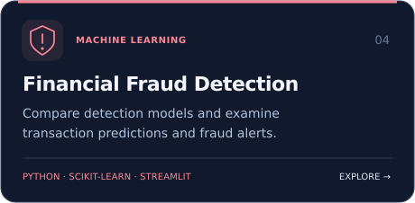
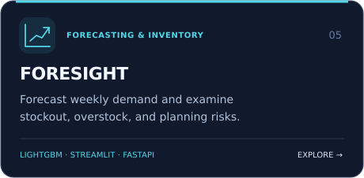
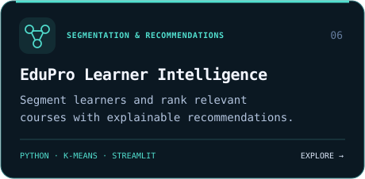

# Hi, I'm Nitesh Kumar 👋

### Data Analyst | Python | SQL | Excel | Power BI | AI & ML

I transform raw data into dashboards, predictive models, and actionable business insights.

**[Portfolio](https://nitesh-datascience.github.io/portfolio/)** · **[LinkedIn](https://www.linkedin.com/in/niteshkumar-codlytic)** · **[Email](mailto:ns0762005@gmail.com)** · **[Projects](#featured-projects)**

[About me](#about-me) · [Skills](#skills) · [Featured projects](#featured-projects) · [Let's connect](#lets-connect)

---

## About me

`$ whoami`

I'm a **BCA graduate based in Delhi, India**, building practical projects in data analytics, business intelligence, and machine learning. My work combines data cleaning, visualization, model evaluation, and clear business reporting.

- **Building:** Interactive dashboards, forecasting tools, and recommendation systems.
- **Learning:** SQL, statistics, Python, and business reporting through hands-on projects.
- **Open to:** Entry-level Data Analyst, Business Analyst, and MIS Executive roles, internships, and analytics collaborations.
- **My approach:** Start with a business question, check the data, and explain what the results mean.

## Skills

`$ ls ~/skills`

| Area | Tools and techniques |
| --- | --- |
| Data analysis | Python, SQL, Pandas, NumPy, data cleaning, exploratory analysis |
| Business intelligence | Excel, Pivot Tables, Power Query, Power BI, KPI reporting |
| Visualization | Matplotlib, Seaborn, Plotly, dashboard design, data storytelling |
| Machine learning | Scikit-learn, classification, clustering, model evaluation |
| Applications & workflow | Streamlit, Jupyter Notebook, VS Code, Git, GitHub |

## Featured projects

`$ open ~/projects`

Click a card to explore the project repository.

  
  

  
  

  
  

<strong>Project details & tools</strong>

| Project | What it explores | Main tools |
| --- | --- | --- |
| [Nassau Candy Profitability](https://github.com/Nitesh-Datascience/Nassau_Candy_Profitability_Project) | Product and division profitability, margin risk, and revenue concentration in an interactive dashboard. | Python, Pandas, Streamlit |
| [Sales MIS Dashboard](https://github.com/Nitesh-Datascience/Sales-MIS-Dashboard-Project-using-Excel) | Sales, profit, and order KPIs with Pivot Tables, regional comparisons, and trend reports. | Microsoft Excel |
| [Customer Churn Prediction](https://github.com/Nitesh-Datascience/Customer_churn_Prediction) | Customer churn patterns, individual risk predictions, and model performance in a dashboard. | Python, Streamlit |
| [Financial Fraud Detection](https://github.com/Nitesh-Datascience/Financial_Fraud_Detection) | Comparison of classification and anomaly models, transaction predictions, and fraud-detection results. | Python, Scikit-learn, Streamlit |
| [FORESIGHT: Demand & Inventory Intelligence](https://github.com/Nitesh-Datascience/FORESIGHT_AI_Demand_Inventory_Intelligence) | Weekly SKU forecasting, rolling backtests, stockout and overstock risks, and inventory planning. | Python, LightGBM, Streamlit, FastAPI |
| [EduPro: Learner Intelligence](https://github.com/Nitesh-Datascience/EduPro_Project) | Learner segmentation, explainable course recommendations, and interactive learner maps. | Python, K-Means, Streamlit |

### CodeVenjar — career & skill-gap platform

[Explore CodeVenjar →](https://github.com/Nitesh-Datascience/CodeVenjar)

A student career platform with skill profiles, personalized roadmaps, course enrollment, mentor booking records, assignments, and portfolio building. Supabase supports authentication and learner records, with a demo mode for exploring the interface.

**More work:** [Shopping Behavior Analysis](https://github.com/Nitesh-Datascience/Customer-Shopping-Behavior-Analysis) · [Care Transition Analytics](https://github.com/Nitesh-Datascience/care-transition-efficiency-analytics) · [APL Logistics](https://github.com/Nitesh-Datascience/https---github.com-Nitesh-Datascience-APL_Logistics) · [Smart Water Tank Monitoring](https://github.com/Nitesh-Datascience/IOT-BASED-Smart-Water-Tank-Monitoring-System)

**[Browse all repositories →](https://github.com/Nitesh-Datascience?tab=repositories)**

## What I can help with

- Clean and structure datasets for analysis.
- Build Excel reports and Power BI dashboards around business KPIs.
- Explore customer behavior, sales performance, and operational trends.
- Develop and evaluate machine-learning models for portfolio projects.
- Present findings through clear charts, dashboards, and project documentation.

<strong>GitHub activity & statistics</strong>

 

  
  

[View my contribution history on GitHub →](https://github.com/Nitesh-Datascience?tab=overview)

## Let's connect

`$ connect --with nitesh`

I'm interested in analytics opportunities, internships, dashboard projects, and collaborations.

**Email:** [ns0762005@gmail.com](mailto:ns0762005@gmail.com)  
**LinkedIn:** [Nitesh Kumar](https://www.linkedin.com/in/niteshkumar-codlytic)  
**Portfolio:** [Explore my projects and skills](https://nitesh-datascience.github.io/portfolio/)

Have a project suggestion or feedback? [Open a GitHub issue](https://github.com/Nitesh-Datascience/Nitesh-Datascience/issues/new?title=Profile%20Feedback) or [send me an email](mailto:ns0762005@gmail.com?subject=GitHub%20Profile%20Feedback).

---

<strong>Clear analysis. Useful dashboards. Better decisions.</strong>

