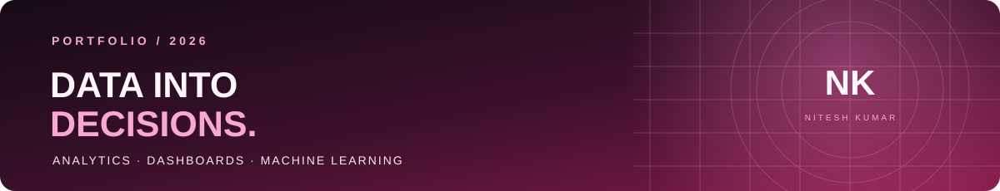
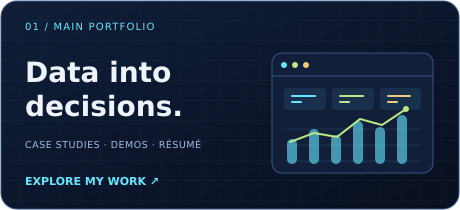

<!-- PROFILE HEADER -->

  

  

  
  
  

  
  
  

---

## NITESH KUMAR / ABOUT

<table>
  <tr>
    <td width="68%" valign="middle">
      <h3>Turning raw data into decisions.</h3>
      
I transform raw data into dashboards, predictive models, and actionable business insights. My work combines analytics, machine learning, data visualization, and practical problem-solving.

      
My workflow spans data cleaning, exploratory analysis, KPI design, model evaluation, visualization, and deploying interactive applications.

      
<strong>Currently focused on:</strong> Data Analyst roles, business intelligence, Python, SQL, Excel, Power BI, and applied AI/ML.

      
<a href="https://nitesh-datascience.github.io/portfolio/"><strong>MAIN PORTFOLIO ↗</strong></a> &nbsp; / &nbsp; <a href="https://nitesh-datascience.github.io/Nitesh-Tree-Portfolio/"><strong>INTERACTIVE TREE PORTFOLIO ↗</strong></a>

    </td>
    <td width="32%" align="center" valign="middle">
      
      
<strong>DATA ANALYST</strong> Business Intelligence Python · SQL · Power BI

    </td>
  </tr>
</table>

## SELECTED WORK / PROJECT CARDS

<table>
  <tr>
    <td width="50%" valign="top">
      
      <h3>01 / Nassau Candy Profitability</h3>
      
Explore product margins, profit concentration, and division performance in an interactive dashboard.

      
<code>PYTHON</code> <code>PANDAS</code> <code>STREAMLIT</code>

      
<a href="https://github.com/Nitesh-Datascience/Nassau_Candy_Profitability_Project"><strong>SOURCE ↗</strong></a> · <a href="https://87v6ndywgm2xvutswekgjm.streamlit.app/"><strong>LIVE DEMO ↗</strong></a>

    </td>
    <td width="50%" valign="top">
      
      <h3>02 / Sales MIS Dashboard</h3>
      
Track sales, profit, order KPIs, and regional trends with a business reporting workbook.

      
<code>EXCEL</code> <code>KPIs</code> <code>REPORTING</code>

      
<a href="https://github.com/Nitesh-Datascience/Sales-MIS-Dashboard-Project-using-Excel"><strong>SOURCE ↗</strong></a> · <a href="https://github.com/Nitesh-Datascience/Sales-MIS-Dashboard-Project-using-Excel/raw/refs/heads/main/mis_dataset_template.xlsx"><strong>WORKBOOK ↗</strong></a>

    </td>
  </tr>
  <tr>
    <td width="50%" valign="top">
      <h3>03 / Customer Churn Prediction</h3>
      
Investigate churn patterns, customer risk predictions, and model performance.

      
<code>PYTHON</code> <code>MACHINE LEARNING</code> <code>STREAMLIT</code>

      
<a href="https://github.com/Nitesh-Datascience/Customer_churn_Prediction"><strong>SOURCE ↗</strong></a> · <a href="https://customerchurnprediction-fkpbjib3muyvrhmgchkurb.streamlit.app/"><strong>LIVE DEMO ↗</strong></a>

    </td>
    <td width="50%" valign="top">
      <h3>04 / Financial Fraud Detection</h3>
      
Compare classification and anomaly-detection approaches for transaction risk.

      
<code>PYTHON</code> <code>SCIKIT-LEARN</code> <code>STREAMLIT</code>

      
<a href="https://github.com/Nitesh-Datascience/Financial_Fraud_Detection"><strong>SOURCE ↗</strong></a> · <a href="https://financialfrauddetection-6geni2xkrt3dc8ry2infsf.streamlit.app/"><strong>LIVE DEMO ↗</strong></a>

    </td>
  </tr>
  <tr>
    <td width="50%" valign="top">
      <h3>05 / FORESIGHT — Demand Intelligence</h3>
      
Forecast demand and investigate inventory, stockout, and replenishment risks.

      
<code>FORECASTING</code> <code>LIGHTGBM</code> <code>STREAMLIT</code>

      
<a href="https://github.com/Nitesh-Datascience/FORESIGHT_AI_Demand_Inventory_Intelligence"><strong>SOURCE ↗</strong></a>

    </td>
    <td width="50%" valign="top">
      <h3>06 / EduPro Learner Intelligence</h3>
      
Explore learner segmentation and personalized course recommendation concepts.

      
<code>PYTHON</code> <code>K-MEANS</code> <code>STREAMLIT</code>

      
<a href="https://github.com/Nitesh-Datascience/EduPro_Project"><strong>SOURCE ↗</strong></a> · <a href="https://eduproproject-jkoe6q6tctk5xafa6ggogf.streamlit.app/"><strong>LIVE DEMO ↗</strong></a>

    </td>
  </tr>
</table>

## PORTFOLIO EXPERIENCES

<table>
  <tr>
    <td width="50%" valign="top">
      
      <h3>Main Portfolio / Analytics</h3>
      
Case studies, projects, skills, and live demos.

      <a href="https://nitesh-datascience.github.io/portfolio/"><strong>OPEN PORTFOLIO ↗</strong></a>
    </td>
    <td width="50%" valign="top">
      
      <h3>Tree Portfolio / Interactive</h3>
      
A creative animated tree with clickable project branches.

      <a href="https://nitesh-datascience.github.io/Nitesh-Tree-Portfolio/"><strong>OPEN TREE PORTFOLIO ↗</strong></a>
    </td>
  </tr>
</table>

## SKILLS / TOOLKIT

  
  
  
  
  
  

**Analytics:** Data cleaning · EDA · KPI reporting · Business storytelling  
**Visualization:** Excel · Power BI · Matplotlib · Plotly · Power Query  
**Machine learning:** Classification · Clustering · Forecasting · Model evaluation  
**Development:** Python · SQL · Pandas · NumPy · Streamlit · FastAPI · Git · GitHub

## A YEAR OF BUILDING

  

  
  

  

  
<strong>MORE LIVE PROJECTS / OPEN TO EXPLORE</strong>

  | Project | Focus | Link |
  | --- | --- | --- |
  | Care Transition Analytics | Transfer efficiency and placement outcomes | [Live app](https://care-transition-efficiency-analytics-knfy8ljtaxyn8ti74zy5ng.streamlit.app/) |
  | FORESIGHT · NorthBay Living | Demand forecasts and inventory risks | [Live app](https://foresightnorthbay-ufqepslzgzysttnkue79rx.streamlit.app/) |
  | Restaurant Growth Analytics | Restaurant growth dashboard | [Live app](https://restaurantgrowthproject-jealfjvy6prolwkmv47cen.streamlit.app/) |
  | CodeVenjar | Career planning prototype | [Live app](https://nitesh-datascience.github.io/CodeVenjar/) |
  | Customer Shopping Behavior | Shopping trends and customer segments | [Repository](https://github.com/Nitesh-Datascience/Customer-Shopping-Behavior-Analysis) |
  | Smart Water Tank Monitoring | IoT monitoring | [Repository](https://github.com/Nitesh-Datascience/IOT-BASED-Smart-Water-Tank-Monitoring-System) |

## CONNECT / LET'S BUILD SOMETHING USEFUL

  
  
  
  

  <strong>Email:</strong> <a href="mailto:ns0762005@gmail.com">ns0762005@gmail.com</a> &nbsp; · &nbsp;
  <strong>LinkedIn:</strong> <a href="https://www.linkedin.com/in/niteshkumar-codlytic">Nitesh Kumar</a>

<em>Build with curiosity. Analyze with care. Explain with clarity.</em>

