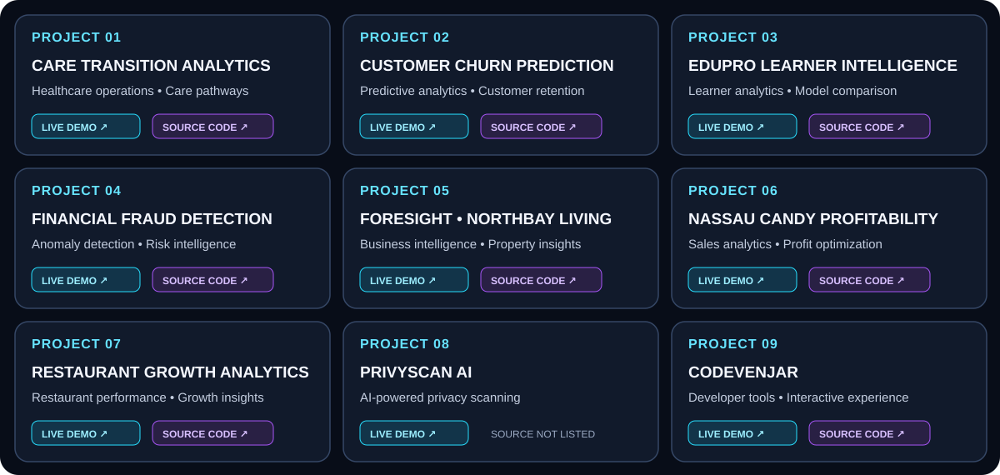
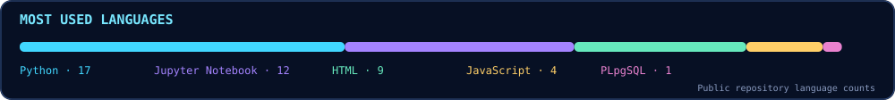
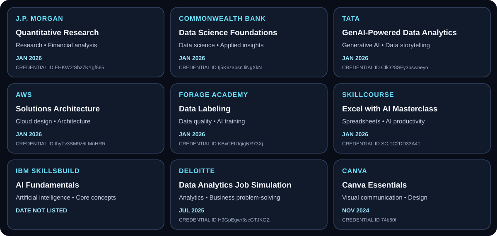

<!-- CODLYTIC | GITHUB PROFILE -->

  

  <strong>DATA ANALYST</strong> &nbsp;·&nbsp;
  
  
  
  

  
  &nbsp;
  
  &nbsp;
  

**I transform raw data into meaningful decisions.** I work across data preparation, exploratory analysis, business intelligence, interactive dashboards, and applied machine learning—turning complex information into clear stories, useful insights, and practical solutions.

**MY WORKFLOW**　01 · Discover the data　→　02 · Reveal meaningful patterns　→　03 · Communicate the insight　→　04 · Enable confident decisions

  

  
  
  
  
  

| **DATA ANALYTICS** | **BUSINESS INTELLIGENCE** | **MACHINE LEARNING** |
|:--|:--|:--|
| Data preparation · EDA · SQL · Statistical analysis | Excel · Power BI · KPI design · Interactive reporting | Classification · Clustering · Forecasting · Model validation |

<strong>SELECTED WORK</strong> · Selected analytics, AI, and developer projects.

  

  

  

  <a href="https://github.com/Nitesh-Datascience?tab=repositories">Browse repositories</a> &nbsp;·&nbsp;
  <a href="https://github.com/Nitesh-Datascience?tab=stars">Starred repositories</a>

  <a href="https://nitesh-datascience.github.io/universe-portfolio/">Universe Portfolio</a> &nbsp;·&nbsp;
  <a href="https://github.com/Nitesh-Datascience/universe-portfolio">Portfolio source</a> &nbsp;·&nbsp;
  <a href="https://nitesh-datascience.github.io/portfolio/">Main portfolio</a> &nbsp;·&nbsp;
  <a href="https://nitesh-datascience.github.io/Nitesh-Tree-Portfolio/">Tree portfolio</a>

  
  

CODLYTIC · DATA · CODE · INNOVATE

