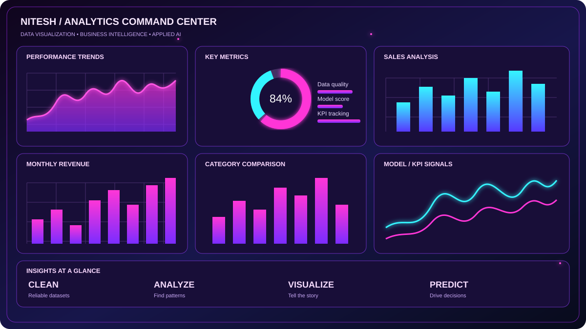
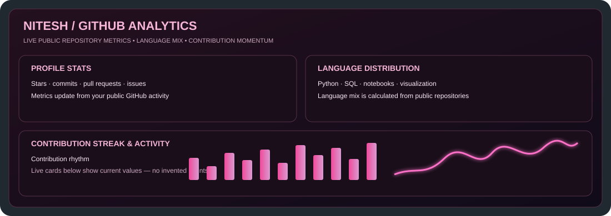

<!-- NITESH KUMAR | NEON MAGENTA DATA ANALYTICS PROFILE -->

  
  
  
  

  

  

  
  

---

## 01 / ABOUT ME — DATA WITH PURPOSE

<table>
<tr>
<td width="68%" valign="middle">

<h2>Hey, I'm Nitesh Kumar 👋</h2>

<strong>DATA ANALYST · PYTHON · SQL · EXCEL · POWER BI · AI / ML</strong>

I transform raw data into dashboards, predictive models, and actionable business insights. My work combines analytics, machine learning, data visualization, and practical problem-solving.

<strong>✦ WHAT I DO</strong> 
▸ Clean, explore, and interpret real-world data 
▸ Build clear KPI dashboards and business reports 
▸ Use Python and SQL to find patterns and answer questions 
▸ Experiment with machine-learning models and evaluate results

<a href="https://nitesh-datascience.github.io/portfolio/"><strong>↗ MAIN PORTFOLIO</strong></a> &nbsp; · &nbsp; <a href="https://nitesh-datascience.github.io/Nitesh-Tree-Portfolio/"><strong>↗ INTERACTIVE TREE PORTFOLIO</strong></a>

</td>
<td width="32%" align="center" valign="middle">

<h3>NITESH KUMAR</h3>

DATA ANALYST · PYTHON · SQL · BI

  

</td>
</tr>
</table>

<strong>✦ TURN DATA INTO CLARITY · TURN CLARITY INTO ACTION ✦</strong>

## 02 / NEON ANALYTICS DASHBOARD

  

<em>Data storytelling through trends, KPIs, comparisons, and predictive signals.</em>

## 03 / TOOLKIT

  

  
  
  
  
  

| DATA ANALYTICS | BUSINESS INTELLIGENCE | AI / MACHINE LEARNING |
|:--|:--|:--|
| Data cleaning · EDA · SQL · statistics | Excel · Power BI · KPI dashboards · storytelling | Classification · clustering · forecasting · model evaluation |

## 04 / FEATURED PROJECTS — BUILT TO SOLVE PROBLEMS

<em>Selected analytics and machine-learning projects. Explore the source code or launch a live demo.</em>

<table>
<tr>
<td width="50%" valign="top">
<h3>📊 Nassau Candy Sales Analysis</h3>

Explore sales performance, profitability patterns, and business KPIs with a data-first approach.

<a href="https://github.com/Nitesh-Datascience/Nassau_Candy_Profitability_Project"><strong>⌘ SOURCE CODE ↗</strong></a> · <a href="https://87v6ndywgm2xvutswekgjm.streamlit.app/"><strong>▶ LIVE DEMO ↗</strong></a>
</td>
<td width="50%" valign="top">
<h3>🧠 Customer Churn Prediction</h3>

Explore churn patterns and customer-risk predictions with a classification workflow.

<a href="https://github.com/Nitesh-Datascience/Customer_churn_Prediction"><strong>⌘ SOURCE CODE ↗</strong></a> · <a href="https://customerchurnprediction-fkpbjib3muyvrhmgchkurb.streamlit.app/"><strong>▶ LIVE DEMO ↗</strong></a>
</td>
</tr>
<tr>
<td width="50%" valign="top">
<h3>🛡️ Financial Fraud Detection</h3>

Analyze transactions and surface suspicious patterns with machine-learning techniques.

<a href="https://github.com/Nitesh-Datascience/Financial_Fraud_Detection"><strong>⌘ SOURCE CODE ↗</strong></a> · <a href="https://financialfrauddetection-6geni2xkrt3dc8ry2infsf.streamlit.app/"><strong>▶ LIVE DEMO ↗</strong></a>
</td>
<td width="50%" valign="top">
<h3>🎓 EduPro Learner Intelligence</h3>

Segment learners and recommend personalized courses based on learning goals.

<a href="https://github.com/Nitesh-Datascience/EduPro_Project"><strong>⌘ SOURCE CODE ↗</strong></a> · <a href="https://eduproproject-jkoe6q6tctk5xafa6ggogf.streamlit.app/"><strong>▶ LIVE DEMO ↗</strong></a>
</td>
</tr>
</table>

## 05 / GITHUB STATS — LIVE ACTIVITY

<em>Live cards below show your public repository stats, language mix, and contribution streak. Counts can change as GitHub updates.</em>

  
  

  

## 06 / MY PORTFOLIOS

  
  

## 08 / LET'S CONNECT

  
  

<strong>LEARN • BUILD • GROW • MAKE AN IMPACT</strong>

