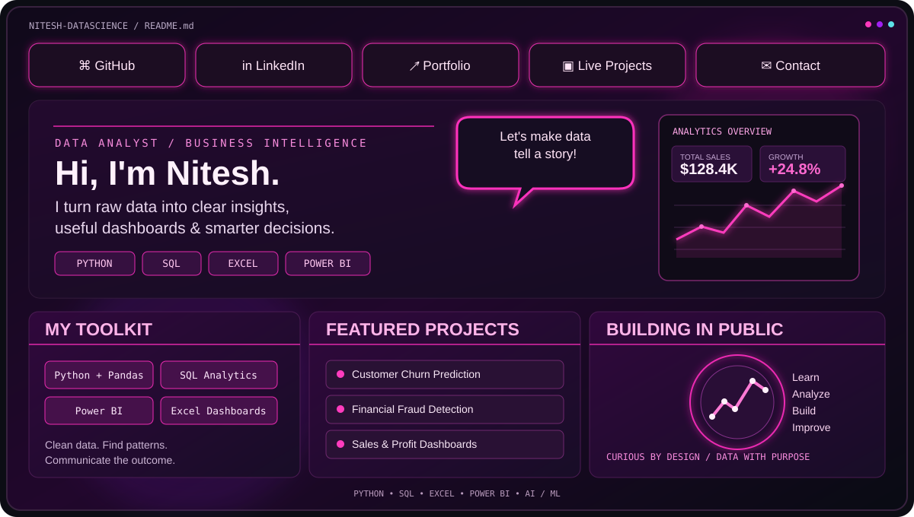
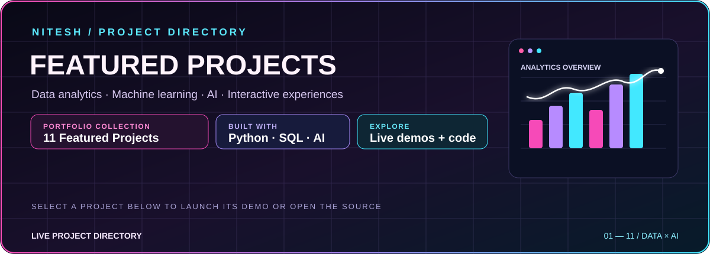
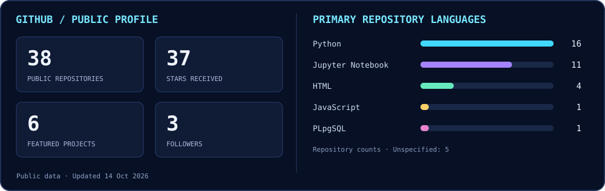

<!-- NITESH KUMAR | NEON MAGENTA DATA ANALYTICS PROFILE -->

  

  
  
  
  

  

  

  
  

---

## 01 / ABOUT ME — DATA WITH PURPOSE

<table>
<tr>
<td width="68%" valign="middle">

<h2>Hey, I'm Nitesh Kumar 👋</h2>

<strong>DATA ANALYST · PYTHON · SQL · EXCEL · POWER BI · AI / ML</strong>

I transform raw data into dashboards, predictive models, and actionable business insights. My work combines analytics, machine learning, data visualization, and practical problem-solving.

<strong>✦ WHAT I DO</strong> 
▸ Clean, explore, and interpret real-world data 
▸ Build clear KPI dashboards and business reports 
▸ Use Python and SQL to find patterns and answer questions 
▸ Experiment with machine-learning models and evaluate results

<a href="https://nitesh-datascience.github.io/portfolio/"><strong>↗ MAIN PORTFOLIO</strong></a> &nbsp; · &nbsp; <a href="https://nitesh-datascience.github.io/Nitesh-Tree-Portfolio/"><strong>↗ INTERACTIVE TREE PORTFOLIO</strong></a>

</td>
<td width="32%" align="center" valign="middle">
<h3>NITESH KUMAR</h3>

DATA ANALYST · PYTHON · SQL · BI

  

</td>
</tr>
</table>

<strong>✦ TURN DATA INTO CLARITY · TURN CLARITY INTO ACTION ✦</strong>

## 03 / TOOLKIT

  

  
  
  
  
  

| DATA ANALYTICS | BUSINESS INTELLIGENCE | AI / MACHINE LEARNING |
|:--|:--|:--|
| Data cleaning · EDA · SQL · statistics | Excel · Power BI · KPI dashboards · storytelling | Classification · clustering · forecasting · model evaluation |

## 04 / FEATURED PROJECTS — LIVE PROJECT DIRECTORY

  

<strong>✦ 11 FEATURED PROJECTS · NEON ANALYTICS · LIVE DEMOS · OPEN SOURCE ✦</strong>

<em>Explore data dashboards, predictive models, learner intelligence, fraud detection and interactive portfolio experiences. Each project card below includes its live demo and source code when available.</em>

<!-- LIVE-PROJECTS:START -->

<table>
<tr>
<td width="50%" valign="top">

✦ PROJECT 01 · DATA / AI
<h3>Care Transition Analytics</h3>

Care pipeline, transfer efficiency and placement outcomes.

&nbsp; 

● LIVE PROJECT DIRECTORY

</td>
<td width="50%" valign="top">

✦ PROJECT 02 · DATA / AI
<h3>Customer Churn Prediction</h3>

Customer segments, churn risk and model performance.

&nbsp; 

● LIVE PROJECT DIRECTORY

</td>
</tr>
<tr>
<td width="50%" valign="top">

✦ PROJECT 03 · DATA / AI
<h3>EduPro Learner Intelligence</h3>

Learner clusters, course recommendations and model comparisons.

&nbsp; 

● LIVE PROJECT DIRECTORY

</td>
<td width="50%" valign="top">

✦ PROJECT 04 · DATA / AI
<h3>Financial Fraud Detection</h3>

Transaction risk, anomaly patterns and classifier comparisons.

&nbsp; 

● LIVE PROJECT DIRECTORY

</td>
</tr>
<tr>
<td width="50%" valign="top">

✦ PROJECT 05 · DATA / AI
<h3>FORESIGHT · NorthBay Living</h3>

Demand forecasts, inventory risks and replenishment planning.

&nbsp; 

● LIVE PROJECT DIRECTORY

</td>
<td width="50%" valign="top">

✦ PROJECT 06 · DATA / AI
<h3>APL Logistics Analytics</h3>

Delivery performance and delay-risk reporting; access required.

&nbsp; 

● LIVE PROJECT DIRECTORY

</td>
</tr>
<tr>
<td width="50%" valign="top">

✦ PROJECT 07 · DATA / AI
<h3>Nassau Candy Profitability</h3>

Product economics, margin risk and division performance.

&nbsp; 

● LIVE PROJECT DIRECTORY

</td>
<td width="50%" valign="top">

✦ PROJECT 08 · DATA / AI
<h3>Restaurant Growth Analytics</h3>

Explore the restaurant growth analysis dashboard.

&nbsp; 

● LIVE PROJECT DIRECTORY

</td>
</tr>
<tr>
<td width="50%" valign="top">

✦ PROJECT 09 · DATA / AI
<h3>PrivyScan AI</h3>

Document-image sensitive text detection and redaction prototype.

 Source repository not listed

● LIVE PROJECT DIRECTORY

</td>
<td width="50%" valign="top">

✦ PROJECT 10 · DATA / AI
<h3>CodeVenjar</h3>

Career planning web prototype; choose “Use local demo” to begin.

&nbsp; 

● LIVE PROJECT DIRECTORY

</td>
</tr>
<tr>
<td width="50%" valign="top">

✦ PROJECT 11 · DATA / AI
<h3>Nitesh Tree Portfolio</h3>

Interactive tree portfolio with project details, filters and animated letters.

&nbsp; 

● LIVE PROJECT DIRECTORY

</td>
<td width="50%"></td>
</tr>
</table>

<!-- LIVE-PROJECTS:END -->

## 05 / GITHUB STATS — LIVE ACTIVITY

  

<em>Neon analytics panel refreshed by the repository's GitHub Actions workflow. Language bars show repository counts, not skill ratings.</em>

  
  

  

## 06 / MY PORTFOLIOS

  
  

## 08 / LET'S CONNECT

  
  

<strong>LEARN • BUILD • GROW • MAKE AN IMPACT</strong>

