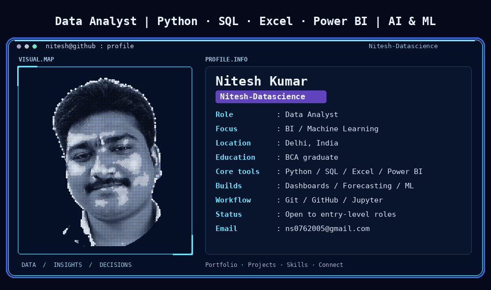
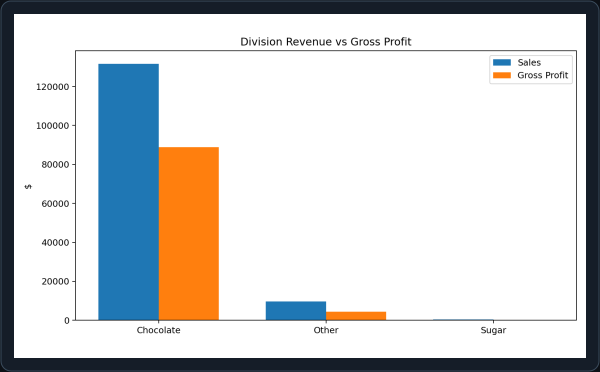
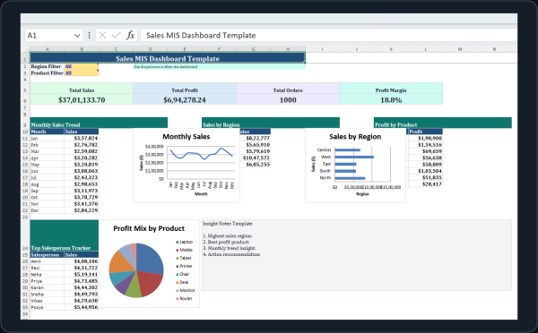
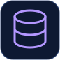
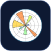
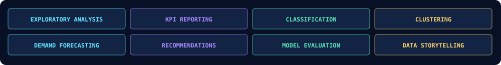

# Hi, I'm Nitesh 👋

  
  
  

**[About me](#user-content-about-me)** · **[Projects](#user-content-featured-projects)** · **[Live projects](#user-content-live-projects)** · **[Skills](#user-content-skills-and-tools)** · **[GitHub stats](#user-content-github-statistics)** · **[Connect](#user-content-connect)**

## About me

I'm **Nitesh Kumar**, a **BCA graduate based in Delhi, India**, building a career in data analytics and business intelligence. My projects cover sales reporting, profitability, customer behavior, forecasting and machine learning.

I work through the whole analysis: **understand the question, clean the data, build and evaluate, and explain the findings**. I use dashboards and clear documentation to make the results easier to explore.

- **Building:** Python dashboards, Excel reports, forecasting tools and recommendation systems.
- **Practicing:** SQL, statistics, model evaluation and business reporting through hands-on projects.
- **Open to:** Entry-level Data Analyst, Business Analyst and MIS Executive roles, internships and analytics collaborations.

## Featured projects

The first two previews come directly from my project repositories. Explore the source code and project guides for setup, methods and results.

<table align="center">
  <tr>
    <td width="50%" valign="top">
      <h3>Nassau Candy Profitability</h3>
      

      
Explore product margins, profit concentration and division performance in a profitability dashboard.

      
<code>Python · Pandas · Streamlit</code>

      
<a href="https://github.com/Nitesh-Datascience/Nassau_Candy_Profitability_Project"><strong>Source code ↗</strong></a> · <a href="https://github.com/Nitesh-Datascience/Nassau_Candy_Profitability_Project#readme">Read project guide</a> · <a href="https://87v6ndywgm2xvutswekgjm.streamlit.app/"><strong>Live app ↗</strong></a>

    </td>
    <td width="50%" valign="top">
      <h3>Sales MIS Dashboard</h3>
      

      
Track sales, profit, order KPIs and regional trends with an Excel reporting dashboard.

      
<code>Excel · KPI reporting · Dashboard charts</code>

      
<a href="https://github.com/Nitesh-Datascience/Sales-MIS-Dashboard-Project-using-Excel"><strong>Source code ↗</strong></a> · <a href="https://github.com/Nitesh-Datascience/Sales-MIS-Dashboard-Project-using-Excel#readme">Read project guide</a> · <a href="https://github.com/Nitesh-Datascience/Sales-MIS-Dashboard-Project-using-Excel/raw/refs/heads/main/mis_dataset_template.xlsx">Download Excel workbook</a>

    </td>
  </tr>
  <tr>
    <td width="50%" valign="top">
      <h3>Customer Churn Prediction</h3>
      

      
Investigate churn patterns, inspect customer risk predictions and review model performance.

      
<code>Python · Machine learning · Streamlit</code>

      
<a href="https://github.com/Nitesh-Datascience/Customer_churn_Prediction"><strong>Source code ↗</strong></a> · <a href="https://github.com/Nitesh-Datascience/Customer_churn_Prediction#readme">Read project guide</a> · <a href="https://customerchurnprediction-fkpbjib3muyvrhmgchkurb.streamlit.app/"><strong>Live app ↗</strong></a>

    </td>
    <td width="50%" valign="top">
      <h3>Financial Fraud Detection</h3>
      

      
Compare classifiers and anomaly-detection models, then inspect transaction predictions.

      
<code>Python · Scikit-learn · Streamlit</code>

      
<a href="https://github.com/Nitesh-Datascience/Financial_Fraud_Detection"><strong>Source code ↗</strong></a> · <a href="https://github.com/Nitesh-Datascience/Financial_Fraud_Detection#readme">Read project guide</a> · <a href="https://financialfrauddetection-6geni2xkrt3dc8ry2infsf.streamlit.app/"><strong>Live app ↗</strong></a>

    </td>
  </tr>
  <tr>
    <td width="50%" valign="top">
      <h3>FORESIGHT: Demand &amp; Inventory</h3>
      

      
Forecast weekly SKU demand with rolling backtests and analyze stockout and overstock risks.

      
<code>LightGBM · Streamlit · FastAPI</code>

      
<a href="https://github.com/Nitesh-Datascience/FORESIGHT_AI_Demand_Inventory_Intelligence"><strong>Source code ↗</strong></a> · <a href="https://github.com/Nitesh-Datascience/FORESIGHT_AI_Demand_Inventory_Intelligence#readme">Read project guide</a>

    </td>
    <td width="50%" valign="top">
      <h3>EduPro Learner Intelligence</h3>
      

      
Segment learners with K-Means and explore explainable course recommendations and learner maps.

      
<code>Python · K-Means · Streamlit</code>

      
<a href="https://github.com/Nitesh-Datascience/EduPro_Project"><strong>Source code ↗</strong></a> · <a href="https://github.com/Nitesh-Datascience/EduPro_Project#readme">Read project guide</a> · <a href="https://eduproproject-jkoe6q6tctk5xafa6ggogf.streamlit.app/"><strong>Live app ↗</strong></a>

    </td>
  </tr>
</table>

## Live projects

Explore my deployed analytics apps and prototypes.

<!-- LIVE-PROJECTS:START -->

| Project | Explore | Demo | Source |
| --- | --- | --- | --- |
| **Care Transition Analytics** | Care pipeline, transfer efficiency and placement outcomes. | [Open app ↗](https://care-transition-efficiency-analytics-knfy8ljtaxyn8ti74zy5ng.streamlit.app/) | [Code ↗](https://github.com/Nitesh-Datascience/care-transition-efficiency-analytics) |
| **Customer Churn Prediction** | Customer segments, churn risk and model performance. | [Open app ↗](https://customerchurnprediction-fkpbjib3muyvrhmgchkurb.streamlit.app/) | [Code ↗](https://github.com/Nitesh-Datascience/Customer_churn_Prediction) |
| **EduPro Learner Intelligence** | Learner clusters, course recommendations and model comparisons. | [Open app ↗](https://eduproproject-jkoe6q6tctk5xafa6ggogf.streamlit.app/) | [Code ↗](https://github.com/Nitesh-Datascience/EduPro_Project) |
| **Financial Fraud Detection** | Transaction risk, anomaly patterns and classifier comparisons. | [Open app ↗](https://financialfrauddetection-6geni2xkrt3dc8ry2infsf.streamlit.app/) | [Code ↗](https://github.com/Nitesh-Datascience/Financial_Fraud_Detection) |
| **FORESIGHT · NorthBay Living** | Demand forecasts, inventory risks and replenishment planning. | [Open app ↗](https://foresightnorthbay-ufqepslzgzysttnkue79rx.streamlit.app/) | [Code ↗](https://github.com/Nitesh-Datascience/foresight_northbay) |
| **APL Logistics Analytics** | Delivery performance and delay-risk reporting; access required. | [Access required ↗](https://https---appcom-nitesh-datascience-apllogistics-464avyacan3btze.streamlit.app/) | [Code ↗](https://github.com/Nitesh-Datascience/https---github.com-Nitesh-Datascience-APL_Logistics) |
| **Nassau Candy Profitability** | Product economics, margin risk and division performance. | [Open app ↗](https://87v6ndywgm2xvutswekgjm.streamlit.app/) | [Code ↗](https://github.com/Nitesh-Datascience/Nassau_Candy_Profitability_Project) |
| **Restaurant Growth Analytics** | Explore the restaurant growth analysis dashboard. | [Open app ↗](https://restaurantgrowthproject-jealfjvy6prolwkmv47cen.streamlit.app/) | [Code ↗](https://github.com/Nitesh-Datascience/restaurant_growth_project) |
| **PrivyScan AI** | Document-image sensitive text detection and redaction prototype. | [Open app ↗](https://privyscan-ai-starter-afe9ltswbslgt9vkczfvxx.streamlit.app/) | — |
| **CodeVenjar** | Career planning web prototype; choose “Use local demo” to begin. | [Open app ↗](https://nitesh-datascience.github.io/CodeVenjar/) | [Code ↗](https://github.com/Nitesh-Datascience/CodeVenjar) |

<!-- LIVE-PROJECTS:END -->

Streamlit apps may sleep when inactive. Select **“Yes, get this app back up!”** to wake an app. **APL requires access.** For CodeVenjar, choose **“Use local demo”** and create a local demo ID.

## Skills and tools

### Data analysis

  
  
  
  

**Python · SQL · Pandas · NumPy**

### Business intelligence

  
  

**Excel · Power BI**

### Visualization and machine learning

  
  

**Matplotlib · Scikit-learn**

### Applications and workflow

  
  
  
  
  
  

**Streamlit · FastAPI · Jupyter · VS Code · Git · GitHub**

Also used across my projects: **Power Query, Pivot Tables, Seaborn, Plotly, K-Means and LightGBM**.

### Analytics and ML focus

## GitHub statistics

Public repository statistics refresh daily. Language bars count repositories by their primary language.

## More from my GitHub

| Project | Focus |
| --- | --- |
| [APL Logistics Analytics](https://github.com/Nitesh-Datascience/https---github.com-Nitesh-Datascience-APL_Logistics) | Delivery performance, delay risk and logistics reporting |
| [Customer Shopping Behavior](https://github.com/Nitesh-Datascience/Customer-Shopping-Behavior-Analysis) | Shopping patterns, customer segments and exploratory analysis |
| [Care Transition Analytics](https://github.com/Nitesh-Datascience/care-transition-efficiency-analytics) | Care-transition efficiency and reporting |
| [Smart Water Tank Monitoring](https://github.com/Nitesh-Datascience/IOT-BASED-Smart-Water-Tank-Monitoring-System) | IoT monitoring project |

  
  

## Connect

I'm interested in analytics opportunities, practical dashboard projects and collaborations.

  
  
  

**Email:** [ns0762005@gmail.com](mailto:ns0762005@gmail.com)  
**LinkedIn:** [Nitesh Kumar](https://www.linkedin.com/in/niteshkumar-codlytic)  
**Portfolio:** [nitesh-datascience.github.io/portfolio](https://nitesh-datascience.github.io/portfolio/)

---

<strong>Build with curiosity. Analyze with care. Explain with clarity.</strong>

