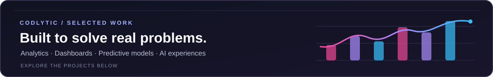

<!-- NITESH KUMAR | DATA ANALYTICS PROFILE -->

  

<table width="100%">
<tr>
<td width="52%" align="center" valign="middle">
  
</td>
<td width="48%" align="center" valign="middle">
  
</td>
</tr>
</table>

  
  
  

  
  

---

## 01 / ABOUT ME — THE ANALYTICS MINDSET

### 👋 Turning Raw Data into Clear Decisions

I'm a **Data Analyst** who enjoys transforming raw data into meaningful insights, interactive dashboards, and practical machine-learning solutions. I like finding the story behind the numbers and making results easy to understand.

<table width="100%">
<tr>
<td width="50%" valign="top">

**🔍 EXPLORE & ANALYSE**

Clean datasets, perform exploratory data analysis, and discover trends and patterns.

</td>
<td width="50%" valign="top">

**📊 VISUALISE & COMMUNICATE**

Create clear KPI reports, interactive dashboards, and data-driven stories.

</td>
</tr>
<tr>
<td width="50%" valign="top">

**🐍 PYTHON & SQL**

Query, transform, and analyse data to answer practical business questions.

</td>
<td width="50%" valign="top">

**🤖 MACHINE LEARNING**

Build and evaluate predictive models for real-world use cases.

</td>
</tr>
</table>

**⚡ MY TOOLKIT**

</td>
</tr>

## 02 / TOOLKIT

### 💻 GITHUB LANGUAGE SNAPSHOT

<strong>A visual snapshot of the languages used across my public repositories</strong>

  
  

Automatically generated from public repository language data. The chart reflects repository code, not skill level or proficiency.

  

  
  
  
  
  

| DATA ANALYTICS | BUSINESS INTELLIGENCE | AI / MACHINE LEARNING |
|:--|:--|:--|
| Data cleaning · EDA · SQL · statistics | Excel · Power BI · KPI dashboards · storytelling | Classification · clustering · forecasting · model evaluation |

## 04 / FEATURED PROJECTS — LIVE PROJECT DIRECTORY

  

<strong>✦ 11 FEATURED PROJECTS · NEON ANALYTICS · LIVE DEMOS · OPEN SOURCE ✦</strong>

<em>Explore data dashboards, predictive models, learner intelligence, fraud detection and interactive portfolio experiences. Each project card below includes its live demo and source code when available.</em>

<!-- LIVE-PROJECTS:START -->

<table>
<tr>
<td width="50%" valign="top">

✦ PROJECT 01 · DATA / AI
<h3>Care Transition Analytics</h3>

Care pipeline, transfer efficiency and placement outcomes.

&nbsp; 

● LIVE PROJECT DIRECTORY

</td>
<td width="50%" valign="top">

✦ PROJECT 02 · DATA / AI
<h3>Customer Churn Prediction</h3>

Customer segments, churn risk and model performance.

&nbsp; 

● LIVE PROJECT DIRECTORY

</td>
</tr>
<tr>
<td width="50%" valign="top">

✦ PROJECT 03 · DATA / AI
<h3>EduPro Learner Intelligence</h3>

Learner clusters, course recommendations and model comparisons.

&nbsp; 

● LIVE PROJECT DIRECTORY

</td>
<td width="50%" valign="top">

✦ PROJECT 04 · DATA / AI
<h3>Financial Fraud Detection</h3>

Transaction risk, anomaly patterns and classifier comparisons.

&nbsp; 

● LIVE PROJECT DIRECTORY

</td>
</tr>
<tr>
<td width="50%" valign="top">

✦ PROJECT 05 · DATA / AI
<h3>FORESIGHT · NorthBay Living</h3>

Demand forecasts, inventory risks and replenishment planning.

&nbsp; 

● LIVE PROJECT DIRECTORY

</td>
<td width="50%" valign="top">

✦ PROJECT 06 · DATA / AI
<h3>APL Logistics Analytics</h3>

Delivery performance and delay-risk reporting; access required.

&nbsp; 

● LIVE PROJECT DIRECTORY

</td>
</tr>
<tr>
<td width="50%" valign="top">

✦ PROJECT 07 · DATA / AI
<h3>Nassau Candy Profitability</h3>

Product economics, margin risk and division performance.

&nbsp; 

● LIVE PROJECT DIRECTORY

</td>
<td width="50%" valign="top">

✦ PROJECT 08 · DATA / AI
<h3>Restaurant Growth Analytics</h3>

Explore the restaurant growth analysis dashboard.

&nbsp; 

● LIVE PROJECT DIRECTORY

</td>
</tr>
<tr>
<td width="50%" valign="top">

✦ PROJECT 09 · DATA / AI
<h3>PrivyScan AI</h3>

Document-image sensitive text detection and redaction prototype.

 Source repository not listed

● LIVE PROJECT DIRECTORY

</td>
<td width="50%" valign="top">

✦ PROJECT 10 · DATA / AI
<h3>CodeVenjar</h3>

Career planning web prototype; choose “Use local demo” to begin.

&nbsp; 

● LIVE PROJECT DIRECTORY

</td>
</tr>
<tr>
<td width="50%" valign="top">

✦ PROJECT 11 · DATA / AI
<h3>Nitesh Tree Portfolio</h3>

Interactive tree portfolio with project details, filters and animated letters.

&nbsp; 

● LIVE PROJECT DIRECTORY

</td>
<td width="50%" valign="top">

✦ PROJECT 12 · DATA / AI
<h3>universe portfolio</h3>

Explore the deployed project and its source code.

&nbsp; 

● LIVE PROJECT DIRECTORY

</td>
</tr>
<tr>
<td width="50%" valign="top">

✦ PROJECT 13 · DATA / AI
<h3>DIWALI UNIVERSE 2026</h3>

Explore the deployed project and its source code.

&nbsp; 

● LIVE PROJECT DIRECTORY

</td>
<td width="50%"></td>
</tr>
</table>

<!-- LIVE-PROJECTS:END -->

## 05 / GITHUB STATS — LIVE ACTIVITY

<strong>Consistent learning, building, and sharing through public repositories.</strong>

  

<h3 align="center">MOST USED LANGUAGES ON GITHUB</h3>

Automatically generated from the languages detected in my public repositories.

  

  

  <a href="https://github.com/Nitesh-Datascience?tab=repositories">Explore my public repositories ↗</a> &nbsp; · &nbsp;
  <a href="https://github.com/Nitesh-Datascience?tab=stars">Explore my starred repositories ↗</a>

<a href="https://github.com/Nitesh-Datascience">View my GitHub profile and contribution activity ↗</a>

## 06 / MY PORTFOLIOS

<strong>Explore my dedicated Data Analyst portfolio, Universe portfolio, project case studies, and interactive work.</strong>

  
  
  
  

## 07 / CERTIFICATIONS &amp; JOB SIMULATIONS

  
  

<em>Industry-designed job simulations, technical masterclasses and professional skills training.</em>

<table width="100%">
<tr>
<td width="33%" valign="top">

### J.P. Morgan
**Quantitative Research Job Simulation**

Forage · Jan 2026

`EHKW2tShz7KYgf565`

</td>
<td width="33%" valign="top">

### Commonwealth Bank
**Introduction to Data Science Job Simulation**

Forage · Jan 2026

`tj5K6zabsnJiNgXkN`

</td>
<td width="33%" valign="top">

### Tata
**GenAI Powered Data Analytics Job Simulation**

Forage · Jan 2026

`Cfk328SFy3pswneyo`

</td>
</tr>
<tr>
<td width="33%" valign="top">

### AWS
**Solutions Architecture Job Simulation**

Forage · Jan 2026

`thyTv3SM9z6LMnHRR`

</td>
<td width="33%" valign="top">

### Forage Academy
**Data Labeling Job Simulation**

Forage · Jan 2026

`KBxCEfzfqigNR73Xj`

</td>
<td width="33%" valign="top">

### Microsoft Excel + AI
**Self-Learning Masterclass**

SkillCourse · Jan 2026

`SC-1C2DD33A41`

</td>
</tr>
<tr>
<td width="33%" valign="top">

### IBM SkillsBuild
**Artificial Intelligence Fundamentals**

Issued by IBM SkillsBuild

AI fundamentals

</td>
<td width="33%" valign="top">

### Deloitte Australia
**Data Analytics Job Simulation**

Forage · Jul 2025

`H9GpEgwr3scGTJKGZ`

</td>
<td width="33%" valign="top">

### Canva
**Canva Essentials**

Canva · Nov 2024

`74b50f`

</td>
</tr>
</table>

  
  
  

Credential IDs are shown for reference. Individual verification links can be added when the certificate URLs are available.

## 08 / LET'S CONNECT

  
  

<strong>LEARN • BUILD • GROW • MAKE AN IMPACT</strong>

